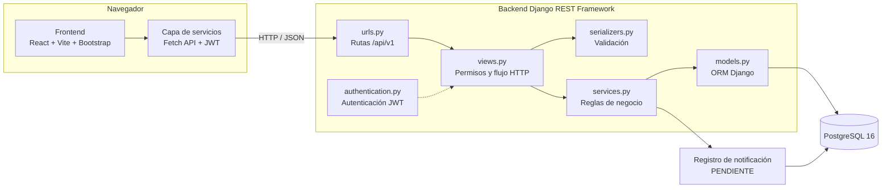

# LaundryDesk — 21st Street Laundry

Aplicación web desarrollada para apoyar la operación del servicio **wash & fold** de 21st Street Laundry, centralizar la administración de pedidos y permitir que el cliente consulte el avance de su ropa mediante un código de seguimiento.

---

## 1. Descripción del proyecto

### Problema

21st Street Laundry opera principalmente como lavandería de autoservicio. Con la incorporación del servicio **wash & fold**, el negocio requiere controlar pedidos que pasan por distintas etapas: recepción, procesamiento, preparación y entrega.

Sin una herramienta centralizada, el seguimiento depende de registros manuales, memoria del personal y llamadas de los clientes para conocer el estado de sus pedidos.

### Solución

**LaundryDesk** propone una aplicación web con dos áreas:

- **Portal público:** acceso sin autenticación para consultar información del negocio y, mediante la API, consultar el estado de un pedido usando un código de seguimiento.
- **Área administrativa:** acceso protegido mediante autenticación JWT para consultar y administrar la operación de los pedidos.

### Valor entregado

**Para el administrador**

- Registro y consulta de pedidos.
- Actualización de información operativa.
- Gestión del estado del pedido.
- Historial de cambios de estado.
- Registro de notas e incidencias.
- Administración de servicios, precios y horarios mediante API.

**Para el cliente**

- Código único de seguimiento.
- Consulta pública del estado mediante API sin crear una cuenta.
- Protección de información privada en las respuestas públicas.

**Para el negocio**

- Una única fuente de información para los pedidos.
- Reglas de dominio para controlar cambios de estado.
- Trazabilidad de cambios.
- Separación entre información pública y administrativa.

### Fuera del alcance del MVP

No forman parte de esta versión:

- Recolección y entrega a domicilio.
- Pagos en línea.
- Cuentas de clientes.
- SMS.
- Integración con lavadoras o secadoras.
- Múltiples empleados con roles diferenciados.

---

## 2. Arquitectura

LaundryDesk utiliza una arquitectura web separada en frontend, backend y base de datos.



### Capas principales del backend

| Capa | Archivo | Responsabilidad |
|---|---|---|
| Rutas | `backend/api/urls.py` | Define los endpoints bajo `/api/v1/`. |
| Autenticación | `authentication.py`, `auth_utils.py` | Generación y validación de JWT. |
| Vistas | `views.py` | Permisos, recepción de solicitudes y respuestas HTTP. |
| Serializadores | `serializers.py` | Validación y transformación de datos. |
| Servicios | `services.py` | Reglas de negocio y transacciones. |
| Modelos | `models.py` | Representación ORM de las tablas de PostgreSQL. |
| Excepciones | `exceptions.py` | Formato centralizado de errores. |

Los modelos utilizan `managed = False` porque el esquema físico de PostgreSQL se administra independientemente de las migraciones de Django.

### Ciclo de vida del pedido

Flujo normal definido en el dominio:

```text
Recibido → En proceso → Listo → Entregado
```

También existe el estado:

```text
Cancelado
```

El backend conserva historial de los cambios y permite correcciones controladas que requieren confirmación y motivo.

> Existe una divergencia conocida entre el SRS y el backend actual: el SRS define la cancelación normal únicamente desde `Recibido`, mientras que la implementación actual también permite cancelar desde `En proceso`.

---

## 3. Stack tecnológico

| Tecnología | Versión / rango | Propósito |
|---|---|---|
| Python | No fijada en el repositorio | Lenguaje del backend |
| Django | `>=5.0,<5.1` | Framework backend y ORM |
| Django REST Framework | `>=3.15,<3.16` | API REST |
| django-cors-headers | `>=4.4,<5.0` | Configuración CORS |
| psycopg | `>=3.1,<4.0` | Conexión con PostgreSQL |
| python-dotenv | `>=1.0,<2.0` | Variables de entorno |
| bcrypt | `>=4.2,<5.0` | Hash de contraseñas |
| PyJWT | `>=2.9,<3.0` | Autenticación JWT |
| PostgreSQL | 16 | Base de datos |
| React | `^19.3.1` | Interfaz web |
| React DOM | `^19.3.1` | Renderizado React |
| React Router | `^7.18.5` | Navegación |
| Bootstrap | `^5.3.8` | Diseño responsivo |
| Vite | `^8.3.6` | Desarrollo y build frontend |
| Fetch API | Nativa | Comunicación frontend-backend |

---

## 4. Instalación y ejecución local

### Requisitos

Antes de iniciar se requiere:

- Git
- Python 3
- PostgreSQL 16
- Node.js
- npm

### 4.1 Clonar el repositorio

```bash
git clone https://github.com/CLA-TC5062-SN2026/TC5062-16.git
cd TC5062-16
```

---

### 4.2 Configurar PostgreSQL

El esquema utilizado durante el proyecto se encuentra en los artefactos de las actividades anteriores, particularmente en:

```text
S05_S06_A1.zip
```

Crear una base de datos:

```text
laundrydesk
```

e importar el archivo `esquema_bd.sql`.

> **Nota de instalación:** el modelo actual `Administrador` utiliza el campo `email`. El esquema SQL inicial del proyecto debe verificarse antes de una instalación limpia para confirmar que dicha columna exista. Si se utiliza una versión anterior del esquema, puede requerirse actualizarla antes de ejecutar la autenticación.

---

### 4.3 Configurar el backend

Desde la raíz:

```bash
cd backend
```

Crear un entorno virtual:

**Windows**

```powershell
python -m venv venv
venv\Scripts\activate
```

**Linux/macOS**

```bash
python3 -m venv venv
source venv/bin/activate
```

Instalar dependencias:

```bash
pip install -r requirements.txt
```

Crear `.env` a partir de la plantilla:

**Windows PowerShell**

```powershell
Copy-Item .env.example .env
```

**Linux/macOS**

```bash
cp .env.example .env
```

Editar las variables necesarias y ejecutar:

```bash
python manage.py check
python manage.py runserver
```

La API estará disponible normalmente en:

```text
http://127.0.0.1:8000/api/v1/
```

---

### 4.4 Crear el administrador

La API cuenta con:

```text
POST /api/v1/auth/register
```

Ejemplo:

```json
{
  "usuario": "admin",
  "email": "admin@ejemplo.com",
  "password": "password-seguro"
}
```

El MVP contempla una sola cuenta administrativa.

---

### 4.5 Configurar el frontend

En otra terminal:

```bash
cd frontend
```

Crear `.env`:

**Windows PowerShell**

```powershell
Copy-Item .env.example .env
```

**Linux/macOS**

```bash
cp .env.example .env
```

La configuración local esperada es:

```env
VITE_API_URL=http://localhost:8000/api/v1
```

Instalar dependencias:

```bash
npm install
```

Levantar Vite:

```bash
npm run dev
```

La aplicación normalmente quedará disponible en:

```text
http://localhost:5173
```

---

## 5. Rutas principales del frontend

| Ruta | Función | Estado |
|---|---|---|
| `/` | Portal público / pantalla de seguimiento | Implementada visualmente; consulta aún simulada en `main` |
| `/login` | Inicio de sesión administrativo | Implementada e integrada con backend |
| `/dashboard` | Área administrativa protegida | Implementada |
| `/pedidos` | Listado administrativo de pedidos | Implementada e integrada con backend |

---

## 6. Endpoints principales

### Autenticación

```text
POST /api/v1/auth/register
POST /api/v1/auth/login
GET  /api/v1/auth/me
```

### Servicios

```text
GET   /api/v1/servicios
POST  /api/v1/servicios
GET   /api/v1/servicios/{id}
PATCH /api/v1/servicios/{id}
```

### Horarios

```text
GET   /api/v1/horarios
POST  /api/v1/horarios
GET   /api/v1/horarios/{id}
PATCH /api/v1/horarios/{id}
```

### Pedidos

```text
GET   /api/v1/pedidos
POST  /api/v1/pedidos
GET   /api/v1/pedidos/{id}
PATCH /api/v1/pedidos/{id}
PUT   /api/v1/pedidos/{id}/estado
GET   /api/v1/pedidos/{id}/cambios-estado
POST  /api/v1/pedidos/{id}/notas
```

### Seguimiento público

```text
GET /api/v1/seguimientos/{codigo_seguimiento}
```

El dominio no utiliza eliminación física de pedidos como operación normal. La cancelación se representa mediante el estado `CANCELADO` para conservar la trazabilidad histórica.

---

## 7. Ejecución de pruebas

### Backend

El repositorio actual no contiene una carpeta:

```text
backend/tests/
```

por lo que no existe una suite automatizada de pruebas Django dentro de `main`.

Durante el proyecto se realizaron pruebas manuales de API y autenticación. La evidencia correspondiente se encuentra en:

```text
S09_A1.zip
```

También se utilizó Postman durante las actividades de construcción e integración de la API.

### Frontend

El frontend incluye una verificación de su capa de servicios:

```bash
cd frontend
npm run verify:servicios
```

Esta validación comprueba aspectos de comunicación HTTP como:

- URL base.
- manejo del JWT;
- envío del token;
- errores de red;
- comportamiento de los servicios.

No sustituye una prueba end-to-end completa del sistema.

---

## 8. Variables de entorno

### Backend — `backend/.env`

| Variable | Obligatoria | Descripción |
|---|---:|---|
| `DJANGO_SECRET_KEY` | Recomendada | Clave interna de Django |
| `DJANGO_DEBUG` | No | Activa/desactiva modo debug |
| `DJANGO_ALLOWED_HOSTS` | No | Hosts autorizados |
| `DB_NAME` | No | Nombre de la base PostgreSQL |
| `DB_USER` | No | Usuario PostgreSQL |
| `DB_PASSWORD` | Sí para conexión autenticada | Contraseña PostgreSQL |
| `DB_HOST` | No | Host PostgreSQL |
| `DB_PORT` | No | Puerto PostgreSQL |
| `JWT_SECRET` | **Sí** | Secreto utilizado para firmar JWT |
| `JWT_EXPIRATION` | No | Vigencia del token en segundos |
| `CORS_ALLOWED_ORIGINS` | No | Orígenes autorizados para frontend |
| `ADMIN_ID_TEMPORAL` | No | Compatibilidad con la etapa anterior del proyecto |

### Frontend — `frontend/.env`

| Variable | Obligatoria | Descripción |
|---|---:|---|
| `VITE_API_URL` | Sí | URL base del backend |

> Los archivos `.env` con valores reales no deben almacenarse en Git.

---

## 9. URL de producción

**Estado de despliegue:** la versión final documentada se ejecuta de forma local.

El repositorio actual no contiene una URL pública de producción verificada.

Backend local:

```text
http://127.0.0.1:8000
```

Frontend local:

```text
http://localhost:5173
```

---

## 10. Capturas de pantalla

Las capturas finales deberán almacenarse, por ejemplo, en:

```text
docs/capturas/
```

### Portal público

```markdown

```

### Inicio de sesión

```markdown

```

### Dashboard administrativo

```markdown

```

### Listado de pedidos

```markdown

```

> Las imágenes deberán capturarse con backend y frontend ejecutándose y utilizando datos representativos de la demo.

---

## 11. Estado funcional actual

### Implementado

- Autenticación administrativa mediante JWT.
- Protección de rutas administrativas.
- Consulta administrativa de pedidos.
- Registro de pedidos mediante API.
- Actualización de información de pedidos mediante API.
- Generación de códigos de seguimiento.
- Historial de cambios de estado.
- Cambio y corrección de estados mediante API.
- Registro de notas e incidencias mediante API.
- Administración de servicios mediante API.
- Administración de horarios mediante API.
- Endpoint público de seguimiento.
- Registro de notificaciones pendientes cuando un pedido queda listo.

### Implementado parcialmente

- Consulta pública de seguimiento: el endpoint del backend es funcional, pero la pantalla `/` de `main` todavía utiliza una respuesta simulada.
- CRUD operativo: la lógica existe principalmente en backend, pero varias operaciones no cuentan con interfaz administrativa.
- Notificación por correo: se registra la solicitud de envío, pero no existe un proceso que envíe físicamente el correo.

### Pendiente

- Interfaz para crear y editar pedidos.
- Interfaz para cambios de estado y cancelaciones.
- Interfaz para notas e incidencias.
- Interfaz administrativa de servicios y horarios.
- Envío efectivo de correos.
- Anonimización automática después del periodo de retención.
- Pruebas automatizadas end-to-end.
- Despliegue público de producción.

---

## 12. Documentación complementaria

El repositorio contiene artefactos desarrollados durante el proyecto:

- `SRS_equipo.md` — especificación de requerimientos.
- `backlog_completo.md` — Product Backlog.
- `diferencias_SRS.md` — análisis de divergencias.
- `code_review.md` — revisión técnica del código.
- `S09_A1.zip` — evidencia de pruebas.
- `matriz_trazabilidad.md` — relación requerimientos–implementación–pruebas.
- `retrospectiva_proyecto.md` — retrospectiva final del proyecto.

---

## 13. Limitaciones conocidas

1. El frontend público de `main` todavía simula la consulta del código de seguimiento.
2. Varias capacidades existentes en backend todavía no cuentan con interfaz gráfica.
3. No existe un worker o servicio que envíe las notificaciones registradas como pendientes.
4. No está automatizada la anonimización de datos personales después del periodo de retención.
5. Existen divergencias conocidas entre algunos requerimientos, contrato e implementación.
6. No existe despliegue público verificado.
7. No existe una suite completa de pruebas automatizadas end-to-end.

---

## 14. Conclusión

LaundryDesk demuestra una arquitectura funcional para centralizar el manejo de pedidos de **wash & fold**, separar las operaciones administrativas de las consultas públicas y conservar trazabilidad sobre el ciclo de vida de cada pedido.

El proyecto alcanzó un mayor grado de implementación en backend que en frontend. Por ello, el núcleo del dominio y la API constituyen la parte más completa del sistema, mientras que varias funcionalidades administrativas todavía requieren una interfaz gráfica para poder considerarse completas de extremo a extremo.

La matriz de trazabilidad y la retrospectiva documentan de forma explícita estas diferencias y el trabajo pendiente.